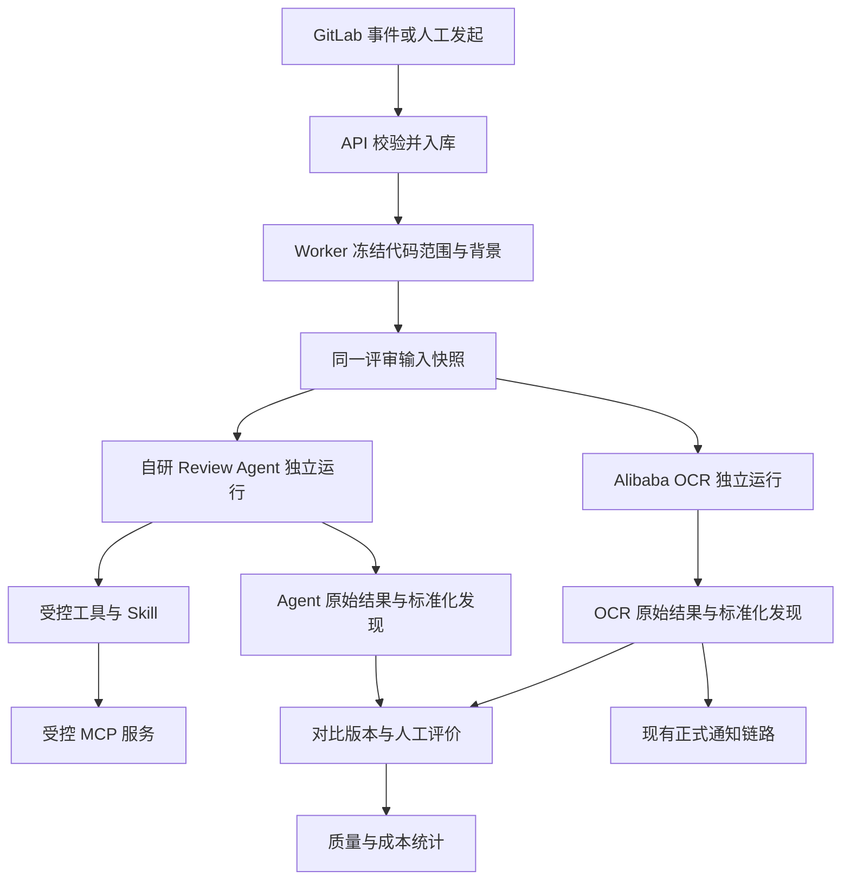

# 自研 Agent 与 Alibaba OCR 双评审规划

日期：2026-11-16（北京时间）。事项：PI-20261116-002。状态：方案已形成，待实施；本文不代表业务功能已开发、测试通过或部署生效。

后续细化：用户进一步要求评估 LangChain 与 LangGraph，技术选型和内部流程见[评审 Agent 框架选型与详细设计](review-agent-framework-design.md)。该文将下述“小规模 Python 验证”建议与“长期优先验证 LangGraph 编排、按需复用 LangChain 组件”分开；均为待验证方案，不代表已引入框架。

## 1. 目标与推荐决策

在现有平台内增加自研评审引擎，对同一份不可变代码输入分别执行 Alibaba Open Code Review（以下简称 OCR）和自研 Agent，独立保存原始结果、结构化发现、执行证据与成本，由人工比较正确性、增量价值和使用成本。

推荐先完成“影子评审”：OCR 继续承担现有正式评审与通知，自研 Agent 在后台独立审查，结果仅进入对比页面。一个任务能看到两路结果；Agent 故障不推翻 OCR 结论，OCR 故障也不阻止已具备有效输入的 Agent 运行。是否将 Agent 纳入正式发布，依据后续人工评价决定。

首版默认方案：

| 决策 | 建议 |
| --- | --- |
| 建设位置 | 复用当前 FastAPI、SQLite、Worker、React 平台，新增独立引擎适配层。 |
| 自研范围 | 自己掌握评审流程、上下文策略、工具权限、Skill、结果协议和评价体系，底层模型通过服务接口调用；本期无需训练模型。 |
| 执行方式 | 双路独立、先串行后按需并发；“两路都审”不要求第一版同时运行。 |
| Agent 形态 | 一个 Agent，固定阶段中允许有限工具循环；暂不建立多 Agent 协作系统。 |
| 模型选择 | 首先验证当前模型端点能否稳定支持工具调用、结构化结果和用量返回，再锁定具体模型及版本。 |
| 输出策略 | OCR 正式结果沿用现有发布；Agent 只供比较，不自动回写 GitLab、发飞书或改变问题状态。 |
| 初始范围 | 选一个项目、固定样本和受控费用进行试点，支持手动发起及项目级抽样。 |
| 暂不纳入 | 自动修复提交、自动合并、任意 Shell、生产数据库访问、全量历史自动重跑。 |

## 2. 当前代码可复用的能力与改造边界

以下来自本轮工作区只读核对，包括尚未提交的既有变更；不据此推断运行实例版本。

| 现有位置 | 已核对能力 | 本方案的接入点 |
| --- | --- | --- |
| `backend/ocr_manager/unified_reviews.py`、`unified_premerge.py` | 合并前与事件关联到统一任务，同版本关联及过期处理。 | 保留任务和事件身份，双评审作为任务下的独立运行。 |
| `backend/ocr_manager/worker.py` | `configuration_snapshot`、`review_job` 固定配置、Git 范围、预检与 OCR 执行。 | 提取可共享的输入准备阶段，再调用引擎适配器。 |
| `backend/ocr_manager/ocr.py` | 核验 manifest、SHA、覆盖集合、预算与结果类型。 | 封装为 `AlibabaOcrEngine`，保留现有结果判定及补审语义。 |
| `backend/ocr_manager/worker_scheduler.py`、`scheduler_config.py` | 单 Worker、模型任务池、同仓库互斥、事件和投递独立槽。 | 新增受同一总配额约束的 Agent 任务类型；第一版保留同仓库串行。 |
| `backend/ocr_manager/artifact_lock.py` | 按任务保护工件，执行与清理互斥。 | Agent 工件增加运行级生命周期保护，清理和删除识别两路引用。 |
| `backend/ocr_manager/review_results.py`、`review_conclusions.py` | OCR 结果投影、初审和补审来源、当前有效结论。 | 新建通用结果读取协议，不把 Agent 塞进 OCR comments 或补审来源。 |
| `backend/ocr_manager/review_finding_feedback.py`、`review_quality.py` | 有帮助／误报／忽略反馈及当前有效发现统计。 | 保留原语义，另建正确性评价与历史实验统计。 |
| `frontend/src/pages/JobDetailPage.tsx`、`FindingsPanel.tsx` | 任务详情与发现展示。 | 增加双评审状态、并排结果和人工评价，通用控件使用 Ant Design。 |

需要优先处理的兼容问题：

1. 当前一份任务的 `result_json`、尝试、有效结论和反馈围绕 OCR 建立，不能直接合并两路 JSON。
2. 当前配置快照包含 OCR 模型和参数。Agent 的模型、Skill、工具、预算需有独立快照，修改 Agent 不应使 OCR 队列失效。
3. 当前同仓库互斥与任务工件锁会限制真实并发；直接在 `review_job` 中开两个线程会绕过容量、取消和清理保护。
4. 当前“有帮助”并不等于缺陷已经被证实；“忽略”也不等于误报。评价正确性必须增加独立判断维度。
5. 当前 Git 准备在 OCR 执行流程内，必须拆出共享输入准备，否则 OCR 配置失败可能让 Agent 永远拿不到输入。

## 3. 总体结构与业务流程



箭头分叉表示独立运行关系，不表示第一版已支持同仓库物理并发。

推荐流程：

1. API 仅校验、鉴权、保存事件或手动比较请求并返回任务标识。
2. Worker 通过可信 GitLab／Git 数据核对范围，冻结输入快照；同一数据库事务登记比较请求及应运行的两路身份。
3. OCR 和 Agent 各有自己的排队、尝试、取消、超时、结果与费用，不把 Agent 建立为 OCR 的一次重试。
4. 按现有同仓库串行规则优先完成 OCR；输入准备成功后，OCR 引擎失败仍允许 Agent 被调度。共享输入本身不可用时，两路明确显示输入失败。
5. 某路结束就展示该路结果；另一侧显示排队、运行中或失败，不用空列表冒充“未发现问题”。
6. 两路结果校验后建立对比版本。首次结果可自动配对；重跑后产生新版本，旧比较、旧反馈与旧费用保留。
7. 人工逐条评价，必要时合并／拆开匹配关系或补录两路都漏掉的问题。
8. 后续是否扩大抽样、增加工具或启用 Agent 发布，通过已冻结评价集和受控试点决定。

### 3.1 输入一致性

共同输入快照至少包括：

- 仓库身份、业务任务身份、来源类型、MR 标识（如有）。
- `base_sha`、`head_sha`、实际 diff 基准和评审模式；单提交记录真实父提交，根提交记录空树基准。
- MR 的实际 merge-base；Push 按已验证的 `before..after`；两者不能仅凭同一个 head SHA 当成同一输入。
- diff 摘要、原始变更清单、允许审查清单、排除清单及原因、路径归一化版本。
- 文件内容对象摘要、背景材料版本、规则正文摘要、输入策略版本。
- 比较协议、抽样规则版本和快照哈希。

工具读取代码只能指定快照中的 Git 对象；禁止改读当前分支 HEAD 或工作区未提交文件。共享 Git 缓存可以复用，HOME、会话、临时输出与工件目录按引擎尝试隔离。

同一比较中要求两路面对相同的目标审查清单；各自内部文件选择和真实完成情况仍需记录。引擎限制无法覆盖共同清单时，显示“范围不完全可比”，不能把遗漏文件裁掉后声称完整。公共文件交集可单列辅助分析，但不能替代完整范围结果。

规则和上下文提供两种实验：

- **流程对照**：尽量使用相同底层模型、规则意图、上下文权限和预算，比较编排、工具使用与验证步骤的价值；双方实际提示词及内部实现不可能完全相同，明确记录这一限制。
- **实际配置对照**：两路使用各自适合的模型、Skill 和 MCP，比较整套系统的业务表现；改进不能单独归因于 Agent 编排。

第一轮默认使用流程对照；如果当前模型不具备工具能力，则采用实际配置对照并标明。两路不能读取本次另一侧的发现、结论、标签或裁判结果。历史回放按截止时间提供知识，屏蔽修复后资料、同一案例标签和后来新增的评论。

## 4. 自研 Agent 如何工作

### 4.1 有界评审流程

```text
校验输入 → 识别变更和风险 → 按规则选择 Skill → 分批审查
       → 按需读取上下文与证据 → 验证候选发现 → 结构化输出 → 服务端校验
```

| 阶段 | 输入与动作 | 输出与结束条件 |
| --- | --- | --- |
| 准备 | 验证快照、路径、模型能力与预算。 | 不合格输入明确失败，不调用模型碰运气。 |
| 分流 | 按文件类型、变更内容、依赖关系选择检查重点。 | 固定批次清单、适用 Skill、风险项。 |
| 审查 | 阅读 diff 和必要上下文；有限轮次调用受控工具。 | 每批候选问题及覆盖状态。 |
| 验证 | 查调用方、类型约束、已有校验、错误处理与反例。 | 保留有证据的问题，无法验证的标注不确定。 |
| 汇总 | 同引擎内去重，整理触发条件、后果与修复方向。 | 符合协议的 JSON，不依赖 Markdown 抽取。 |
| 校验 | 服务端核对路径、行号、SHA、证据引用、覆盖和预算。 | `complete`、`partial`、`failed`、`skipped` 等真实终态。 |

每条发现要求包含：标题、类别、严重性、定位、触发条件、代码证据、影响、修复建议、已检查的反例。模型置信度可记录但不是正确性证明；不记录模型隐藏推理。

初始预算可采用每次运行 10 分钟、最多 12 轮模型交互、40 次工具调用、最多 1 次结构修复，均为待试点调整的建议值。总输入／输出 Token 和金额上限需按所选模型、样本规模与可用计费数据另行设置。嵌套调用、重试和补全共同计入同一预算；先预留后执行，不能层层重置。

“完整”只表示计划中的审查单元按协议完成，不代表代码无缺陷。达到预算后保留有效发现及未完成单元，标为部分完成，禁止将中途退出判为零问题。

### 4.2 工具、Skill 与 MCP 的分工

Agent 决定下一步需要什么证据；Skill 描述检查方法；工具执行明确操作；MCP 是接入外部工具与上下文的协议。MCP 不决定评审流程，也不自动提供准确率保障。官方架构、工具协议与 Skill 规格见第 12 节。

首版工具建议：

| 工具 | 能力 | 边界 |
| --- | --- | --- |
| `list_changed_files` | 读取冻结的变更与覆盖清单。 | 由平台产生，模型不能改写目标范围。 |
| `get_diff` | 读取指定文件／块的固定版本差异。 | 有大小与分页上限，明确截断。 |
| `read_file` | 按 SHA 与行范围读文件。 | 校验路径、对象类型与版本，拒绝越界及符号链接逃逸。 |
| `search_code` | 在冻结快照中查符号、调用方和约束。 | 限仓库、限返回量；文本搜索不冒充完整调用图。 |
| `read_review_context` | 读取已冻结的 MR 背景和受控规范。 | 带来源版本与时间，不能查询另一引擎本次结果。 |
| `load_skill` | 加载批准版本的检查方法和参考资料。 | 只能读已冻结目录，不执行仓库中随意新增的脚本。 |

后续再接 AST／语言服务、静态分析及特定测试。运行测试意味着执行被审查代码，需要单独的隔离执行器、无生产凭据、资源限制和网络限制；首版不开放此能力。

首批 Skill 建议为 `review-core`、`backend-correctness`、`frontend-state`、`security-boundaries`，覆盖证据要求、业务逻辑、前端状态与鉴权边界；后续根据真实漏报增加重试幂等、事务一致性等专题。

Skill 使用 `SKILL.md` 与参考资料目录，包含适用范围、检查步骤、反例、证据要求和退出条件。运行时先加载名称／描述，命中后加载正文，引用资料按需读取。除标准格式外，平台单独保存版本、内容哈希、适用语言、准入状态和回归样本。Skill 自报的工具权限只能缩小平台授权，不能扩大权限。

同一任务冻结 Skill 内容；修订后影响新运行，不能改变旧尝试。来自待评审提交的 `AGENTS.md`、`SKILL.md` 和代码注释作为待审材料，未经批准不能升级为控制指令。可信规范由平台配置或批准的规范版本提供。

### 4.3 MCP 接入顺序

第一版核心代码读取用原生工具，以便严格约束 SHA；完成基础闭环后接一个受控 MCP，验证其真实增量价值。

1. **规范／业务文档 MCP**：只读批准范围，返回文档版本、内容摘要和检索证据。
2. **GitLab 只读 MCP**：必要时读取固定版本背景；优先复用已有 GitLab 适配器。现有评论可能泄漏 OCR 结果，默认不向评审 Agent 开放。
3. **代码检索 MCP**：只有它能证明索引对应目标 SHA 时才作为强证据，否则提示版本不匹配，不用于给出确定性结论。

Agent 作为 MCP Host，通过官方 Python SDK 或经过验证的兼容客户端连接服务。对 Server、工具名、参数范围、可访问项目、超时及输出大小建立允许列表。工具 schema 固定进运行快照；远端突然变化不能悄悄扩大权限。

本轮已核对 MCP `2026-07-28` 工具规范；实施时固定 SDK、协议版本和目标 Server 的兼容矩阵，不把较早版本的握手／会话假设直接用于新协议。第三方 Server 只支持旧协议时显式选择适配版本，并记录到运行快照。

凭据由服务端适配器持有，模型上下文不接触 Token；文档与代码内容作为不可信数据处理。网络只允许批准端点，禁止由模型任意指定地址访问内部服务。MCP 声明只读不能代替服务端实际鉴权。停用 Server 后新调用立即拒绝，在途调用有界结束并保留失败事实。

### 4.4 技术栈选择

本节保留初版轻量验证路线；长期框架选型与恢复设计以后续[详细设计](review-agent-framework-design.md)为准。

推荐首版：Python 显式状态机 + Pydantic 结果协议 + 模型适配器 + 受控工具注册表 + MCP 客户端。任务、运行、评价继续写 SQLite，工件保存在现有受控数据目录。

模型适配器先做一个经验证的 provider，实现 `generate_with_tools` 和结构化结果校验。兼容某种聊天 API 不等于工具调用、JSON schema、取消和费用字段完全兼容；这些能力在试点前逐项验证，锁定依赖版本。

LangGraph 可作为后续编排选择，其官方定位包含有状态流程和持久化执行；本项目首版节点较少、已有 Worker 和业务队列，建议先保持运行链路易审计。若以后引入 LangGraph，checkpoint 只负责执行恢复，不能成为第二套业务事实或另起一套重复消费队列。

Alibaba 官方 delegation 模式可让 OCR 负责文件选择与规则解析，宿主 Agent 负责审查。这可以降低输入准备成本，但应作为可选适配器：它不产生额外一份 OCR 独立判断；使用后须明确两路共享的工程组件。首版优先以平台冻结的 Git 输入为准，并将 OCR preview 作为核对证据；上线前验证本机固定 OCR 版本，不能把官网当前命令直接当作本机支持结论。

## 5. 运行、结果与评价的数据设计

以下是逻辑实体和候选表名，实施时按迁移规范确定物理结构，不在规划阶段修改数据库。

| 实体 | 关键数据 | 责任 |
| --- | --- | --- |
| `review_input_snapshots` | job、SHA、diff／文件清单、规则／背景摘要、版本、快照哈希。 | 固定可比较的业务输入。 |
| `review_engine_runs` | job、input、engine、配置快照、配置哈希、运行序号、状态、取消标记。 | 独立调度身份；区分 `alibaba_ocr` 与 `custom_agent`。 |
| `review_engine_attempts` | run、attempt、执行代次、起止时间、终态、覆盖、工件、Token、费用。 | 保留失败、重试及未知成本，不覆盖历史。 |
| `review_engine_findings` | attempt、稳定 finding_id、位置、事实主张、严重性、证据、Skill 来源。 | 保留每个引擎的原始发现身份。 |
| `review_comparisons` | input、实验配置、两路 run／attempt／结论 revision、比较版本、状态。 | 固定一对结果，不能随“最新结果”漂移。 |
| `review_comparison_links` | 比较版本、左／右 finding_id、关系、建议／确认、操作者、版本。 | 多对多匹配及撤销／拆分，不合并原文。 |
| `review_evaluations` | finding 或比较主题、真实性、价值、严重性评价、依据、操作者、版本。 | 追加人工评价历史，冲突返回 409。 |
| `review_reference_issues` | 输入／基准集、人工确认的问题、证据、所属数据集版本及关联发现。 | 补录两路都漏掉的问题，支撑限定基准内的召回统计。 |

### 5.1 身份与结果协议

- run 唯一性由 `job_id + input_snapshot_id + engine + engine_config_hash + run_sequence` 等业务键约束；请求另带唯一幂等键，避免重复点击建立多组计费运行。
- 自动重试保留 run，追加 attempt；用户有意重跑增加 run_sequence 并记录原因。旧结果不被新 attempt 覆盖。
- finding 使用含引擎／run／attempt 的全局身份；旧 OCR finding_id 保留映射，不能只拿数组下标对齐 Agent。
- comparison 固定具体尝试和补审结论 revision。补审变更只能形成新的对比版本，不能改写已评价的那一版。
- 结果至少包括 `schema_version`、输入身份、引擎与配置版本、终态、覆盖、发现、警告、费用及工具证据引用。
- 引擎配置快照包含模型／端点配置标识及修订、生成参数、Agent 代码和提示词摘要、Skill 内容摘要、工具 schema、MCP 版本与允许范围、预算和输出协议；凭据只保存安全引用，不进入快照正文。远端实际返回的文档内容另存证据摘要与版本，支持事后复核。
- 覆盖以实际计划单元计数，同时提供文件维度投影。两路分组粒度不同不能直接比较组数；`complete` 仍需服务端核验集合。
- 原始 JSON、脱敏工具轨迹与证据存受控工件；数据库保存可检索事实和摘要。原始结果按敏感工件管理，接口只返回白名单，不展示秘密或隐藏推理。
- 费用记录 input／output／cache Token、定价快照、币种和可用性；无法计算时写未知，禁止记成 0。比较总费用包括失败与重试，墙钟耗时和执行耗时分别记录。

### 5.2 与 OCR 旧链路的渐进兼容

第一阶段 OCR 仍由现有任务队列领取；新增的 OCR engine run 作为该次执行的明确映射，由同一完成事务更新。不得让旧队列和新引擎队列同时调度一次 OCR 调用。Agent 由新任务类型领取自己的 run。

`review_jobs.status` 在兼容期继续表示正式 OCR 状态，页面明确标为“OCR 正式评审”；双路状态另设字段和徽标。Agent 仍运行时可以显示“OCR 已完成／Agent 运行中”，不会把两者压成一个含糊的完成状态。

历史 OCR 只读映射为单引擎历史，未知输入、模型或费用保留未知，不虚构 Agent 结果。历史回放是单独显式操作，先预览范围和预算；若原始输入或配置证据不足，标明不可严格对照，按新快照重新跑两路后再作正式比较。

影子 Agent 发现不自动进入正式待跟进问题、旧质量统计、飞书或 GitLab 发布；需要采纳时人工选择，并保存 engine run 和 finding 来源。防止影子噪声改变现有业务结论。

## 6. 调度、故障隔离与恢复

- 共同准备成功后，两路独立领取与失败，SQLite 唯一约束及执行代次负责防重和迟到写入保护。
- Agent 共享现有模型任务总配额，默认并发 1、低于正式任务优先级；设置最大等待或轮转份额防止一直饥饿，不另起绕过容量的 Worker。
- 第一版继续同仓库串行。后续真并发须先拆分 Git 缓存修改锁与运行级只读快照，分别保护工件和 HOME，并验证清理、取消及进程栅栏。
- Agent 独立工件目录建议为 `runs/<job-id>/engines/<engine>/<run-id>/<attempt>/`。不长期持有阻塞 OCR 投递的旧任务排他锁；新增运行生命周期锁，并使删除／维护在短锁内核对所有活跃引用后再清理。
- 双路重试各自有最大次数、退避和分类。超时、限流可按预算重试；输入不合法、鉴权失败、能力不兼容要人工纠正，不能无限重跑。
- API 取消指定引擎或整个比较；被替代 MR 使相关运行过期，取消待执行任务，在途有界停止，保留历史。旧版本不得继续正式发布。
- Worker 崩溃先确认受控进程退出和栅栏释放，再恢复任务。模型调用超时可能已计费；记录成本未知，不承诺外部模型“恰好调用一次”。
- MCP 不可用时按工具重要性处理：缺少必要证据则部分完成或失败；可选增强资料缺失可以继续但明确警告，不能编造证据。
- Agent 完成不创建默认投递；OCR 通知沿用独立投递与去重。后续启用双路摘要需独立设计发布授权和幂等键。

## 7. 人工对比页面

任务详情新增“评审对比”页签，保留现有 OCR 详情。页面结构建议：

1. 顶部展示共同 base/head、背景／规则版本、比较版本、可比性提示。
2. 两路摘要展示模型、配置版本、状态、覆盖、发现数、耗时、Token 和费用；运行中不显示假零值。
3. 主区按问题主题组织，桌面两列、窄屏切换标签；支持“全部／双方均报告／仅 OCR／仅 Agent／待人工确认／仅基准存在”。
4. 逐条展示原始文字、代码定位、触发条件、影响及证据。自动匹配只给候选，人工可以合并、拆开、撤销。
5. 人工评价至少包括“成立／不成立／证据不足”“有价值／低价值／不采纳”“严重性合理／高估／低估”，依据可选附注；事实成立与是否值得处理分开。
6. 支持录入两路都漏掉的问题；其来源、证据和对应版本必须可追溯。
7. 明确提供“仅重跑 OCR”“仅重跑 Agent”“新建两路比较”，展示输入与预算，保存新结果版本。
8. 第二阶段增加盲评：随机 A／B、评价完成后揭示引擎，后台仍保留真实来源。

位置匹配不能只按文件和行号：同一行可能有不同问题，一个根因也可能跨文件。先按路径／版本／位置与类别建立候选，再结合事实主张确认。首版人工校正优先；后续语义匹配模型必须在两路结果冻结后运行，其费用单列，且不能充当最终正确性裁判。

交互按项目 Ant Design 规范实现，保留权限、加载／失败／空状态、分页、窄屏、URL 状态、评价草稿及 409 冲突处理。评审结果可沿用现有只读角色，标注和重跑由服务端按写权限校验。

## 8. 如何判断哪个更准确

建议先比较四个问题：哪些发现真的成立、哪路发现了另一侧没有的真实问题、两路漏了什么、获得这些结果的成本是多少。

下表精确率与召回率采用官方教学资料 R9 中的标准定义；面向评审发现的去重、标注范围与基准构造是本项目的评价约定。“误报比例”明确指发现中的错误占比，不使用分母为全部真实负例的统计学 false positive rate 名称。

| 指标 | 口径 | 不能得出的结论 |
| --- | --- | --- |
| 已标注样本精确率 | `TP / (TP + FP)`，只计已裁定的有效问题主张；展示分子分母。 | 不叫全量准确率，不把未评价或证据不足算正确。 |
| 误报比例 | `FP / (TP + FP)`，同一评价范围。 | 忽略／不采纳不能自动记 FP。 |
| 独有真实发现 | 经人工确认且另一侧未报告的独立问题数。 | 多写几条重复描述不增加价值。 |
| 基准内召回率 | `TP / (TP + FN)`，分母来自独立人工基准集。 | 双方输出并集不是完整真值，不能用它宣称总体召回率。 |
| 完成与覆盖 | 全量入选运行的成功、部分完成、失败、跳过和覆盖比例。 | 只看双成功样本会隐藏可靠性差异。 |
| 标注完成度 | 已裁定、未标注、证据不足的数量与比例。 | 少数样本的高比例不是稳定能力证明。 |
| 成本与效率 | 每个输入的总费用、每个独立真实问题费用、P50/P95 耗时。 | 未知费用不是零；串行排队时间不算模型计算速度。 |

重复发现保留原始记录，评价集按“输入版本内的独立问题”去重，并另报重复率。某项无分母时显示不适用，不显示 0% 或 100%。每张统计固定输入集合、引擎版本、模型、Skill、MCP 权限、结果版本和评价截止时间。

同输入、双路覆盖完整的配对样本用于主要质量对比；不完整样本另列并纳入可靠性和成本统计，不能静默丢弃。样本达到可分析规模后按语言、风险、规模和项目分层，展示原始计数及区间，避免只比较单个百分比。

建议用 20～30 个分层样本完成第一轮可用性试验，随后积累 50～100 个具备人工结论的样本再决定推广；这些是工作量起点，不是统计充分性保证。样本含已知缺陷、正常变更、跨文件修改和大 diff；已知缺陷样本从修复前版本审查。

规范、Skill 的迭代使用开发集；独立保留验证集和最终留出集。评价标签、修复提交、另一引擎输出及后验知识不允许进入该样本的评审输入。人工反馈先变成可回放案例，再修改 Skill 并对留出集验证；不自动把每条反馈写成全局规则。

## 9. 分阶段交付

以下为一名熟悉本项目开发者的初步工程投入估算，需在第一阶段核对端点能力和实施细节后修订；不含人工持续标注等待、外部服务阻塞及真实试点费用。

| 阶段 | 预计投入 | 交付物 | 验收门槛 |
| --- | --- | --- | --- |
| 一：协议与输入 | 2～3 人日 | 双引擎协议、输入快照、结果身份、迁移设计及假引擎。 | 相同代码范围能产生两份可追溯结果；旧 OCR 行为回归通过。 |
| 二：Agent 最小运行 | 4～6 人日 | 模型适配、6 个受控工具、首批 Skill、预算与结果校验。 | 固定样本跑通；越权、截断、超时、坏 JSON、取消均有真实状态。 |
| 三：对比与标注 | 3～5 人日 | 任务页对比、候选匹配、人工评价、独立重跑、基础统计。 | 结果版本固定、反馈不串路、Agent 故障不改变正式 OCR。 |
| 四：MCP 与受控试点 | 3～5 人日 | 一个只读 MCP、版本化证据、项目抽样和评估报告。 | 证明上下文隔离与成本可控，获得一批人工评价数据。 |
| 五：按效果增强 | 按证据另估 | 盲评、检索／静态分析、真并发、正式发布策略。 | 只有在独有真实发现、误报和预算达到约定目标后推进。 |

前三阶段约 9～14 人日形成可手工使用的双评审闭环，前四阶段约 12～19 人日完成首轮 MCP 试点准备。部署和真实样本运行须分别留下证据；不能用上述估算承诺某天完成或具体准确率。

建议实施时第一批改动围绕以下模块逐步展开，名称可随实际职责收敛：

```text
backend/ocr_manager/
  review_engine_contracts.py       双引擎输入与输出协议
  review_input_snapshots.py        不可变输入准备与校验
  review_engine_store.py           运行、尝试与工件引用
  review_agent.py                  有界评审流程
  review_agent_tools.py            固定版本代码读取工具
  review_agent_skills.py           可信 Skill 版本加载
  review_agent_mcp.py              MCP 准入与调用适配
  review_comparisons.py            结果配对、关系与评价
  review_comparison_api.py         鉴权和管理接口
  review_engine_migration.py       独立迁移
review-skills/                     批准发布的评审方法
frontend/src/pages/                任务对比与标注业务组件
```

API 候选为 `GET /api/jobs/{id}/engine-runs`、`GET /api/jobs/{id}/comparisons`、`POST /api/jobs/{id}/comparisons`、`POST /api/engine-runs/{id}/reruns` 和版本化评价接口。新增请求仅入库；具体路径在契约阶段与现有路由核对后确定。

## 10. 实施验证与发布门槛

必须覆盖：

- 幂等与迁移：重复 webhook／重复比较请求；旧 OCR 历史、发现身份、补审与通知不变；空库和代表性旧库升级与恢复。
- 输入：MR／Push／单提交区别、merge-base、根提交、重命名、删除、纯换行、二进制／超大文件、上下文版本及过期 MR。
- 隔离：一侧失败、单侧取消／重跑、Worker 中断、迟到结果、费用未知、删除及工件清理不影响另一侧。
- 安全：路径穿越、符号链接、恶意 Skill／代码注释、MCP 返回指令、越权项目、未知工具和网络端点、秘密泄漏。
- 质量：坏 JSON、虚构行号／证据、预算耗尽、覆盖缺口；配对错位、重复问题、未知评价、历史反馈和基准泄漏。
- 页面：两路不同状态、旧结果保留、人工匹配、409 草稿、分页、桌面与窄屏、只读角色限制。

以下是实施后可执行的现有工程命令，本轮规划未运行这些业务门禁：

```sh
.venv/bin/pytest -q backend/tests
.venv/bin/ruff check backend/ocr_manager backend/tests
.venv/bin/mypy backend/ocr_manager
PYTHONPATH=backend .venv/bin/python -m ocr_manager.openapi_contract
npm --prefix frontend run lint
npm --prefix frontend test
(cd frontend && npx tsc -b && npx vite build --outDir /tmp/ocr-dual-review-dist --emptyOutDir)
(cd frontend && OCR_BROWSER_FRONTEND_DIST=/tmp/ocr-dual-review-dist npx playwright test)
```

新增专项测试应随功能提供真实命令与隔离夹具，不把尚不存在的测试文件写成已通过。自动化先使用合成数据和模型／MCP 替身；真实付费模型、真实项目代码发送和生产 MCP 接入在试点配置明确后执行。

发布保留项目级 `ocr_only`／`dual_shadow` 两种初始模式，默认 `ocr_only`。先停写并检查在途任务，完成数据库与凭据配置成对备份、隔离恢复演练，再发布同版 API、Worker、monitor 和前端。新迁移编号在实施时读取实际最新版本分配。

运行回退优先关闭 Agent 新任务入口并排空在途运行，保留所有结果。数据库回退使用升级前成对备份与新增数据补偿方案，不能手动降低版本号或直接换旧程序继续写新版库。

## 11. 本轮交付边界与下一步

本轮只交付规划文档、索引与台账，没有新增业务实现、安装 SDK、调用真实模型／MCP、执行数据库迁移或发布服务。没有读取私有配置或扫描其他聊天。当前模型工具能力、真实费用和独立 Agent 准确率均未验证。

下一步建议从第一阶段开始：确定不可变输入和引擎结果契约，以假引擎先验证双路结果、独立失败和旧链路兼容，再加入真实 Agent。模型和首批 Skill 的细节根据试点项目确定，不阻塞协议与数据层设计。

## 12. 官方技术依据

核对日期：2026-11-16。以下仅支持相关技术概念，不能代替本机固定版本兼容测试；规划中的数据结构、预算、阶段和权限策略是本项目建议。

| 编号 | 来源地址 | 本文采用范围 |
| --- | --- | --- |
| R1 | `https://github.com/alibaba/open-code-review/blob/main/skills/open-code-review-delegate/SKILL.md` | OCR delegation 的文件选择、规则解析与宿主 Agent 审查分工；第 4.4 节。 |
| R2 | `https://agentskills.io/specification` | Skill 目录、`SKILL.md` 及元数据格式；第 4.2 节。 |
| R3 | `https://agentskills.io/client-implementation/adding-skills-support` | Skill 的目录、正文、引用资料分级加载与可信来源；第 4.2 节。 |
| R4 | `https://modelcontextprotocol.io/docs/2026-07-28/learn/architecture` | MCP Host／Client／Server 和上下文交换职责；第 4.2、4.3 节。 |
| R5 | `https://modelcontextprotocol.io/specification/2026-07-28/server/tools` | 工具 schema 与调用协议，工具注解可信性边界；第 4.3 节。 |
| R6 | `https://modelcontextprotocol.io/docs/2026-07-28/tutorials/security/security_best_practices` | 凭据、SSRF、本地 Server 与最小权限设计；第 4.3 节。 |
| R7 | `https://github.com/modelcontextprotocol/python-sdk` | 官方 Python MCP 客户端／服务端 SDK；第 4.3、4.4 节。 |
| R8 | `https://docs.langchain.com/oss/python/langgraph/overview` | LangGraph 编排、持久化执行与框架边界；第 4.4 节。 |
| R9 | `https://developers.google.com/machine-learning/crash-course/classification/accuracy-precision-recall` | 精确率与召回率定义及分母区别；第 8 节。 |
