# Open Code Review 管理平台操作手册

版本日期：2026-11-20

本手册面向平台管理员和评审结果处理人员，覆盖首次接入、日常查看、人工反馈、异常恢复和自建 Agent 试点。界面图片来自隔离演示环境，项目名、地址、编号和结果均为示例，不包含真实凭据。

## 1. 开始前准备

- 已按[部署说明](deployment.md)启动 API、Worker 与前端，并能打开管理台。
- 已在 GitLab 创建项目访问令牌，采用满足实际操作的最低角色，并授予 `api` 与 `read_repository` scope。
- 已准备模型 Provider 的 API Key。若需要飞书通知，已创建群机器人并取得 Webhook URL；建议启用签名校验。
- 正式环境应配置管理鉴权并限制管理页网络访问。不要把任何密钥、Webhook URL 或令牌写入截图、Issue、日志或仓库。

## 2. 首次接入总览

打开 **系统设置 → 接入帮助**，或直接进入 **项目接入清单**。清单分别核对项目接入、模型、Git/GitLab API 和通知，不把“已保存配置”当作“真实评审已经成功”。

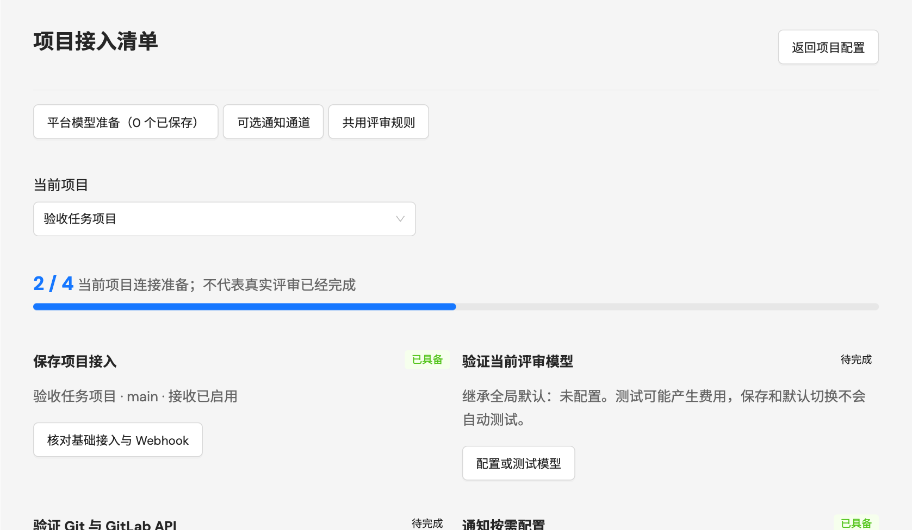

建议按下列顺序完成：

1. 新增并测试评审模型。
2. 按需新增并测试飞书通知通道。
3. 添加 GitLab 仓库并选择触发方式。
4. 在 GitLab 配置 Webhook。
5. 回到项目接入诊断核对连接。
6. 触发一次真实测试事件，在任务详情核对结果、覆盖和通知。

## 3. 配置评审模型

1. 打开 **系统设置 → 评审模型**，点击 **新增模型**。
2. 填写配置名称、Provider 和 API Key。自定义 OpenAI 兼容服务时填写无凭据的 HTTPS API 根地址，通常以 `/v1` 结尾。
3. 点击 **自动获取模型** 后选择模型；目录接口不可用时可手动填写模型标识。
4. 如需费用估算，展开单价字段并按每百万 Token 填写。
5. 点击 **保存模型**。

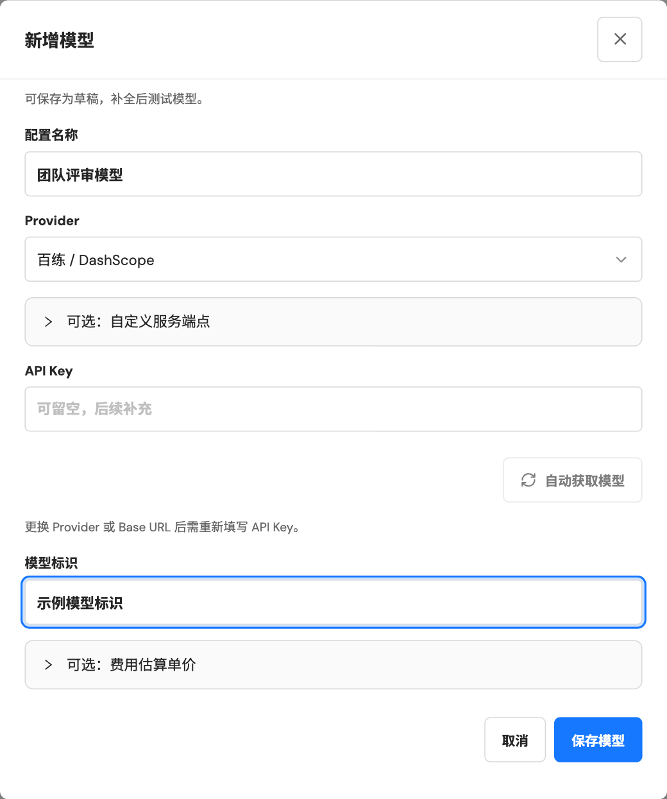

保存后还要完成两项操作：

1. 在模型卡片点击 **测试 模型**，确认后执行。测试可能产生费用。
2. 测试通过后，按需点击 **设为默认**。测试不会自动切换默认模型。

系统同一时间只有一个全局默认模型。项目也可在编辑窗口的 **评审参数** 中指定其他已保存模型。切换默认模型前，建议先等待队列清空。

## 4. 配置飞书通知

1. 打开 **系统设置 → 飞书通知**，点击 **新增飞书配置**。
2. 填写配置名称和机器人 Webhook URL。
3. 如机器人启用了签名校验，填写同一机器人的签名密钥。
4. 点击 **保存通知通道**。

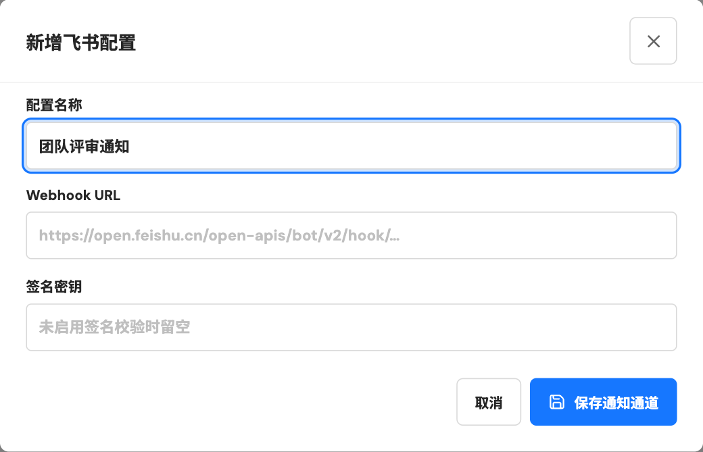

保存后在对应卡片点击 **测试 飞书**。该操作会向真实群发送测试消息，确认前请核对目标群。项目未关联通知通道时，评审仍可运行，但不会发送飞书消息。

## 5. 添加 GitLab 项目

1. 打开 **项目配置**，点击 **添加仓库**。
2. 填写无凭据的 HTTPS 项目地址或 Clone 地址，以及 GitLab Token。
3. 等待页面显示 **仓库已识别**。平台会通过 Worker 获取项目身份和默认分支。
4. 选择 1 至 20 个目标分支。
5. 按需选择飞书配置。
6. 选择触发方式：
   - **合并前 MR 评审**：接收 MR 新建、重新打开或更新事件。
   - **目标分支 Push 评审**：评审一次快进 Push 的 `before..after` 净差异。
7. 点击 **保存仓库**。

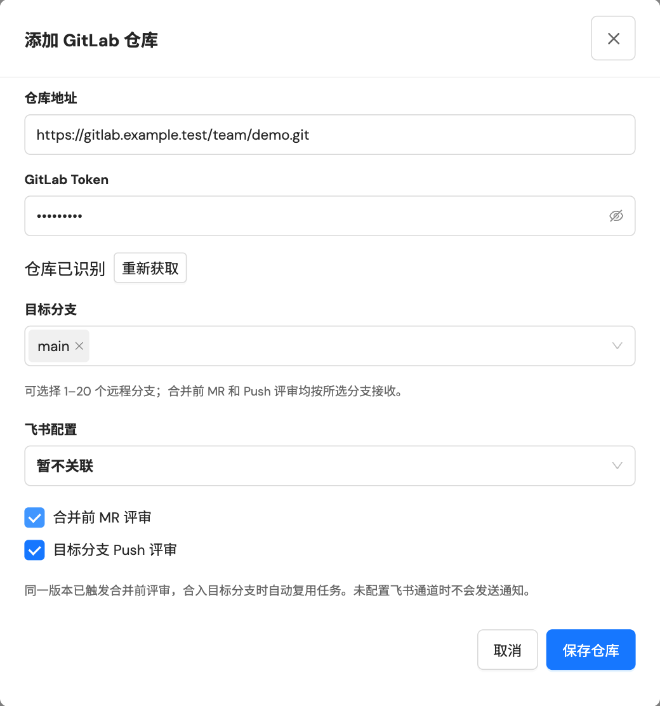

编辑已有项目时，GitLab Token 留空表示保留原凭据。更换 GitLab 主机时必须重新输入 Token。修改地址、分支或令牌后，要重新测试连接。

## 6. 配置 GitLab Webhook

项目配置页顶部显示所有项目共用的回调地址。点击 **复制地址**。

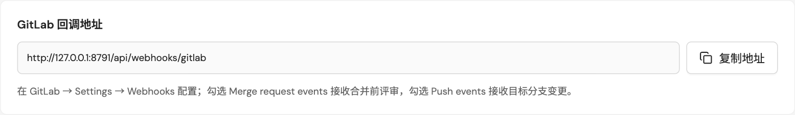

在 GitLab 项目中执行：

1. 打开 **Settings → Webhooks**。
2. 将管理台复制的地址填入 URL。
3. 在管理台项目卡片查看或复制该项目独立的 Webhook Token，并填入 GitLab Secret token。
4. 已启用合并前评审时勾选 **Merge request events**。
5. 已启用目标分支 Push 评审时勾选 **Push events**。
6. 保持 SSL verification 开启并保存。

GitLab 必须能访问回调地址。正式部署应通过受控 HTTPS 入口只转发 `/api/webhooks/gitlab`。项目、分支或事件不匹配时不会创建任务；错误 Secret 返回 HTTP 401。平台不会自动修改远端 Webhook。

## 7. 验证项目接入

打开 **项目配置 → 编辑项目 → 接入诊断**。这里读取已保存状态，不会因为打开页面就执行外部调用。

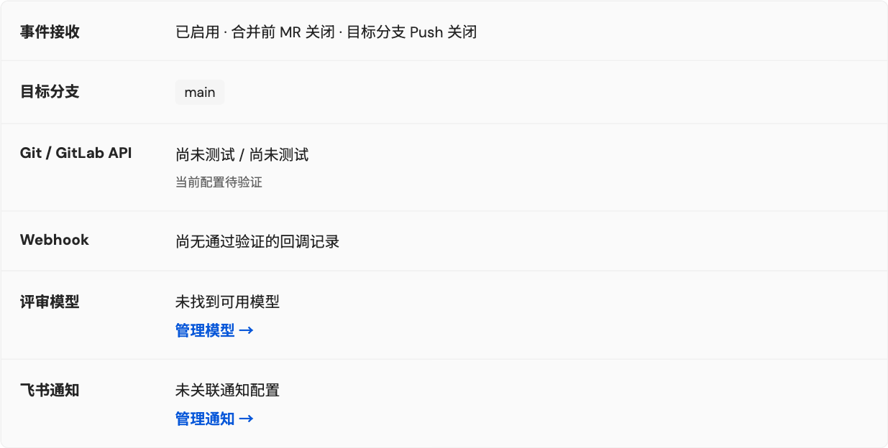

按顺序核对：

1. 事件接收开关和目标分支是否正确。
2. Git 与 GitLab API 最近测试是否成功。
3. Webhook 是否出现最近通过验证时间。
4. 生效模型是否为预期的全局或项目指定模型。
5. 飞书通知是否关联到预期通道。

连接测试只认可当前保存配置。模型测试可能产生费用，飞书测试会发送真实消息。修改配置后，历史成功不能替代重新测试。

最后在 GitLab 发送测试事件，或明确提交一次符合条件的 MR 更新/Push。然后到 **评审任务** 找到对应提交，核对执行快照、覆盖范围、模型用量和通知状态。项目接入清单达到 4/4 也不等于真实评审已完成。

## 8. 查看评审任务

打开 **评审任务**。顶部状态和筛选先在服务端生效，再分页展示。可按来源、项目、发现反馈、提交人和日期查询。

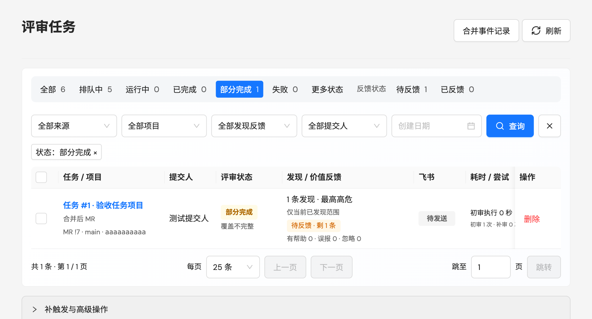

重点区分这些状态：

- **已完成**：完整执行结束；仍需阅读发现，不能仅凭状态判断代码可合并。
- **部分完成**：只代表当前已发现范围，不能把发现数当作完整结果。
- **失败**：查看失败阶段和诊断证据后再决定重新评审。
- **排队中 / 运行中**：不要重复触发相同事件；先到运行监控核对 Worker。
- 飞书状态与评审状态相互独立。通知失败优先重发通知，不要重跑模型。

漏投或历史 MR 可展开 **补触发与高级操作**，按项目和 IID 补触发。批量重新评审会再次调用模型并可能产生费用，只对明确选中的当前页终态任务操作。

## 9. 阅读任务详情

点击任务编号打开详情。页面优先展示结论与发现，执行与恢复、覆盖与费用、文件与历史、通知与尝试按需展开。

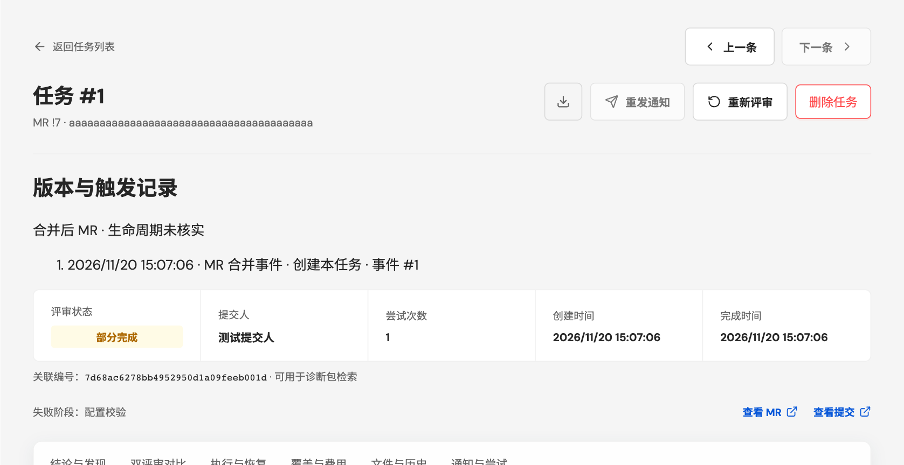

建议按以下顺序阅读：

1. 核对项目、MR 或 Push 范围、提交 SHA 和提交人。
2. 查看评审状态、失败阶段和状态原因。
3. 阅读每条评审发现和对应文件。
4. 打开 **覆盖与费用**，确认原始范围、实际候选、完成/失败文件和 Token 估算。
5. 打开 **执行与恢复**，查看各次尝试、补审资格与诊断证据。
6. 打开 **通知与尝试**，分别核对飞书与 GitLab 行内发布结果。

右上角操作的含义：

- **重发通知**：只重发飞书，不运行 OCR。
- **重新评审**：再次调用模型，可能产生费用，不会修改代码。
- 下载图标：下载脱敏报告，仍应按内部资料保护。

## 10. 反馈评审发现

每条发现提供三种价值反馈：

- **有帮助**：认可这条评审判断。
- **误报**：判断该发现不成立。
- **忽略**：本次不采纳，但不判断对错。

三者互斥，再次点击已选按钮可撤销。反馈只更新这条发现的评价，不会修改代码，也不会自动更改跨任务跟进问题状态。

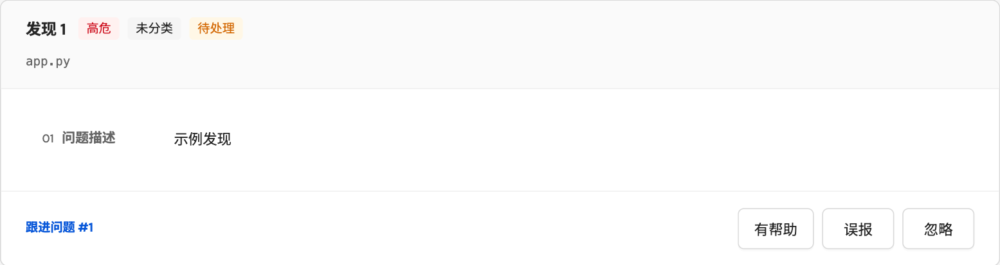

需要集中处理时，可从导航进入 **评审发现**，按项目、反馈、级别和关键字筛选。批量反馈只作用于明确选择的当前页发现；发生版本冲突时先刷新核对，不自动重试。

## 11. 跟进问题处置

点击发现中的 **跟进问题 #编号** 打开问题详情。这里用于跨任务跟踪，与上一步的发现价值反馈分开保存。

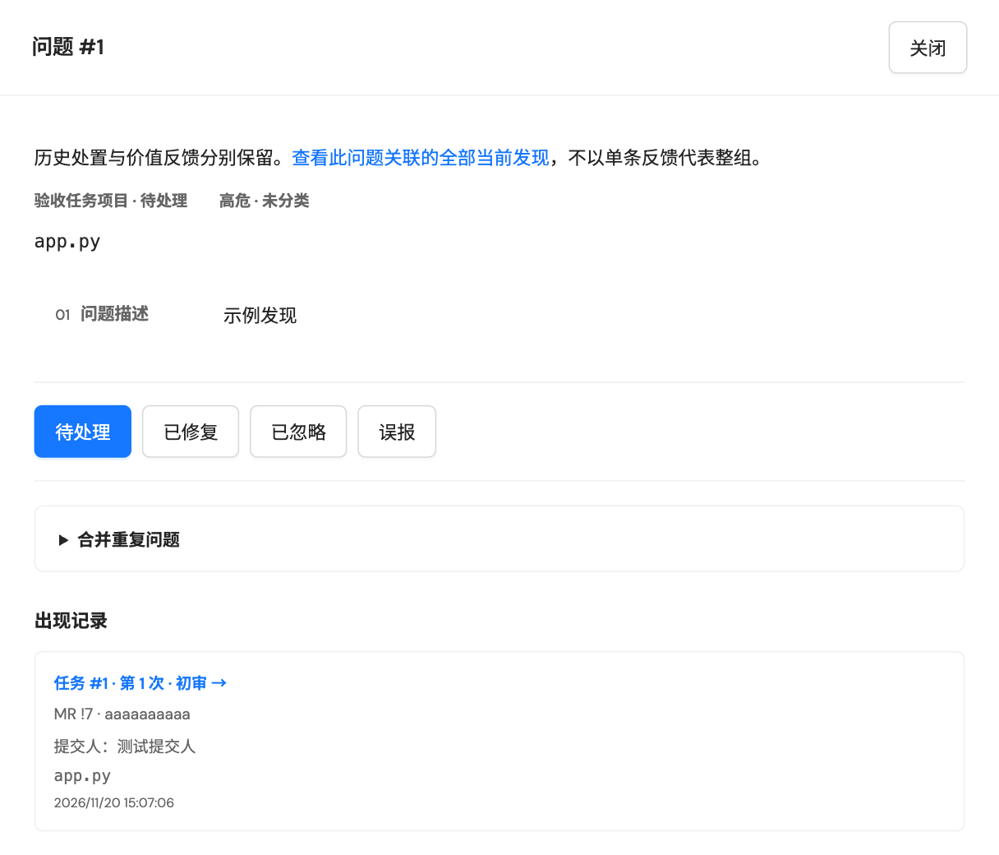

可选择：

- **待处理**：仍需后续处理。
- **已修复**：人工声明已处理，不代表系统已验证代码。
- **已忽略**：决定不处理，不等于误报。
- **误报**：确认问题判断不成立。

变更状态前会要求确认，可填写处理说明。页面保留出现记录和处理记录。合并重复问题时，只能在同一项目内选择目标问题，并先核对源、目标编号。

## 12. 处理部分完成和失败

在任务详情先查看失败阶段、文件级失败、请求报告和覆盖。不要根据 HTTP 504、大文件或超时标签直接推断唯一根因。

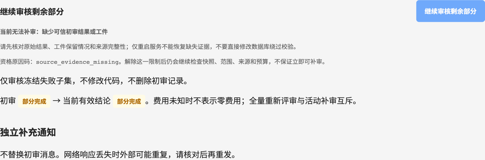

处理原则：

1. 仅飞书失败：点击 **重发通知**。
2. 有可信初审结果和冻结失败子集：按页面资格提示继续审核剩余部分。
3. 页面显示来源证据、工件、快照或预算不满足：先补齐/恢复证据，不要改数据库绕过校验。
4. 需要完整重新运行：点击 **重新评审**，确认费用影响。
5. Worker 或执行槽异常：打开 **运行监控**，核对心跳、槽位和待处理队列。

补审与全量重新评审互斥。补审不修改代码、不删除初审记录，补充通知也不替换原通知。

## 13. 自建 Agent 试点

管理员可打开 **系统设置 → 自建 Agent**。默认方案可以复制为草稿，在草稿中编排 Skill、固定文件补查和只读 MCP 规范查询。

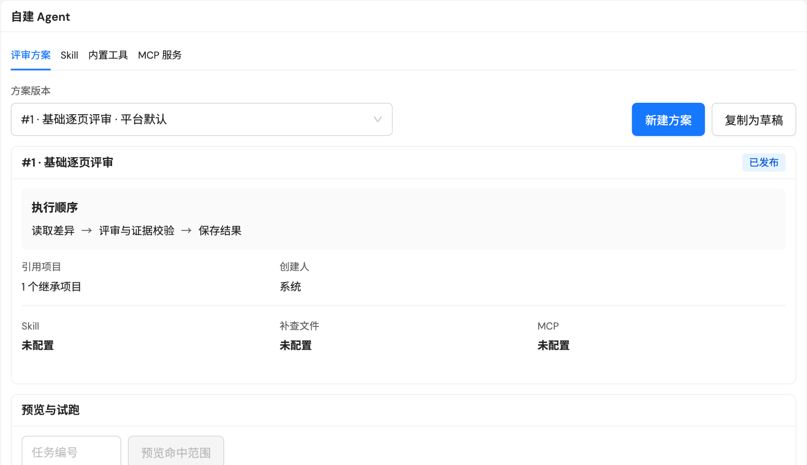

推荐试点流程：

1. 在 **Skill** 中创建与样本文件类型匹配的检查方法并发布版本。
2. 回到 **评审方案**，复制基础方案为草稿，加载 Skill；按需添加补查文件或 MCP 查询。
3. 在草稿输入已有任务编号，点击 **预览命中范围**。预览不调用模型。
4. 点击 **试跑此方案** 并确认，查看独立双评审记录和证据引用。
5. 满意后发布方案。
6. 打开 **项目配置 → 编辑项目 → 自建 Agent**，启用仓库试点、选择方案和模型，保存设置。

草稿试跑不会重新发送既有 OCR、飞书或 GitLab 发布链路。发布后的方案、Skill 和 MCP 服务版本使用不可变记录；修改内容应创建新版本。MCP 只应授权只读规范检索工具。

## 14. 常见问题速查

| 现象 | 优先核对 | 建议操作 |
| --- | --- | --- |
| 没有生成任务 | Webhook 最近时间、事件开关、目标分支、Secret | 在 GitLab 发送测试事件；查看合并事件记录 |
| 项目连接测试失败 | 仓库地址、Token scope、目标分支、Worker | 保存正确配置后重新测试 |
| 任务长期排队 | Worker 心跳、模型槽、同仓库互斥 | 打开运行监控，不重复触发 |
| 评审部分完成 | 覆盖、失败文件、请求报告、补审资格 | 有资格则补审，否则修复证据后重评 |
| 飞书未收到 | 项目关联通道、飞书独立状态、测试消息 | 只重发通知，不先重跑模型 |
| GitLab 没有行内评论 | 项目发布开关、Token 权限、发现能否定位新增行 | 在通知与尝试中核对并逐条重试 |
| 模型费用不明 | 各次尝试 Token 与单价快照 | 费用为预估值，缺数据不按零处理 |
| 反馈后问题状态没变 | 发现反馈与跟进问题是两个维度 | 到跟进问题详情单独处置 |

## 15. 操作完成检查表

- 模型已保存、测试通过，并明确是否设为全局默认。
- 飞书通道如需使用，已保存并发送真实测试消息。
- 项目已识别，目标分支和触发开关正确。
- GitLab Webhook 地址、Secret 和事件类型已同步。
- 接入诊断中的 Git、GitLab API、Webhook、模型和通知均已核对。
- 已执行至少一次真实试运行，并在任务详情核对提交、范围、结果和通知。
- 已明确部分完成、失败和通知失败的不同恢复路径。
- 发现价值反馈与跟进问题处置按各自用途填写。

更完整的字段、规则优先级、账号权限和运维边界见[后台配置与接入操作](configuration-guide.md)和[项目总览](project-overview.md)。
