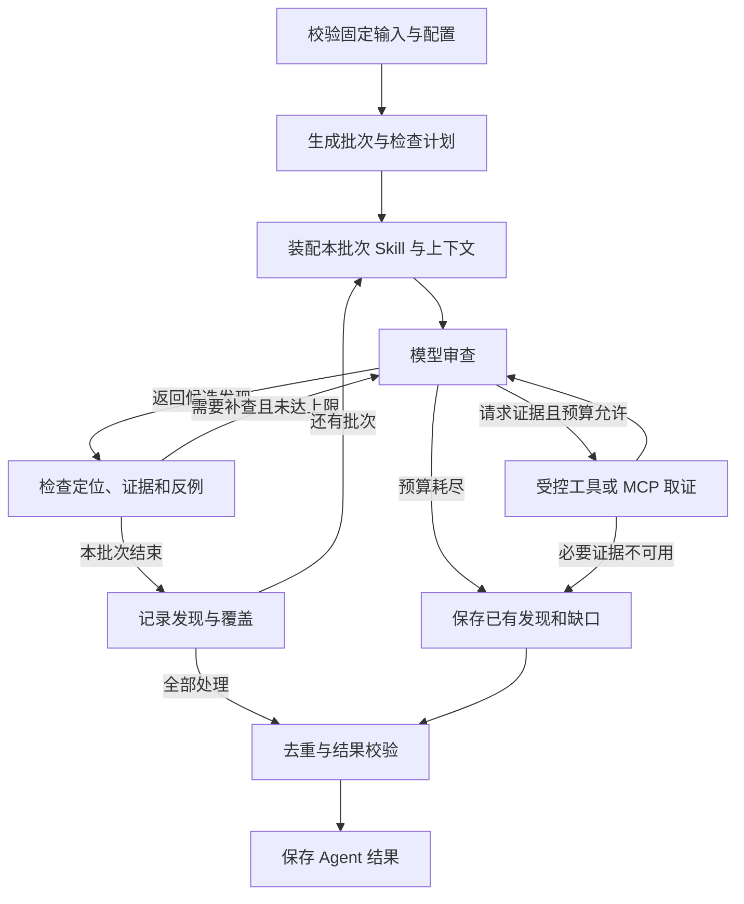

# 自研评审 Agent 的框架选型与详细设计

日期：2026-11-16（北京时间）。事项：PI-20261116-002。状态：技术规划，待实现和兼容性验证。

本文细化[双评审总体方案](dual-engine-review-agent-plan.md)，只讨论自研 Agent 内部结构。Alibaba OCR 独立评审、同输入比较、人工评价和发布边界沿用总体方案。框架事实依据本轮核对的官方资料，见第 12 节；推荐路线、数据契约和验证标准是本项目设计判断。

## 1. 推荐结论与上轮方案的关系

建议长期路线采用：**评审领域逻辑自研 + LangGraph 控制运行流程 + 按需使用 LangChain 的模型／工具组件**。

采用框架仍然是自研 Agent：如何理解变更、取得上下文、执行检查、验证证据和评价结果，均由本项目设计。框架负责部分通用执行能力，不代替业务判断。

上一版建议先用 Python 显式状态机，是以快速验证双路闭环、暂不引入复杂运行时为前提。本轮用户要求深入规划可持续演进的 Agent，因此将建议细化为：

- **小规模验证**：纯 Python 或 LangChain `create_agent` 都可用于验证模型和工具能否配合，选择最少工作量的方式。
- **持续产品实现**：优先验证自定义 LangGraph 外层流程，配合薄模型适配层。若恢复、依赖或兼容成本不符合本机约束，保留 Python 显式流程作为退出路线。
- 不同时长期维护三套执行引擎。下述路线比较用于选型，实施后只保留一条正式运行路线。
- 本轮不安装框架，不将推荐记为已确定依赖版本、已验证兼容或已批准上线。

## 2. LangChain 与 LangGraph 分别解决什么

这里的 LangChain 指 Python 开源框架，不泛指整个产品生态。模型是实际执行推理的组件；框架组织模型和工具如何工作。[R1、R3、R8]

| 对比项 | LangChain | LangGraph |
| --- | --- | --- |
| 主要职责 | 模型、消息、工具等接口，以及可配置的 Agent 循环。 | 显式定义状态、节点、分支与循环，支持执行持久化和恢复。 |
| 典型入口 | `create_agent`；也可只使用模型或工具组件。 | `StateGraph`；本项目优先图方式表达必经步骤。 |
| 使用方式 | 配置模型、工具、提示词和 middleware，执行模型与工具的循环。 | 指定何时分析、取证、验证、补查和结束。 |
| 自定义方式 | 自定义工具、模型、输出协议、middleware 和上下文。 | 自定义节点、条件边、状态字段及子流程。 |
| 本项目用途 | 模型适配、工具消息、结构化结果、可选的局部 Agent 循环。 | 把输入校验、有限取证、候选验证和结果终结组合为明确流程。 |
| 恢复与人工介入 | `create_agent` 基于 LangGraph，可配置 checkpointer 等能力。 | 直接控制 checkpoint 与 interrupt 的位置和使用方式。 |

上述能力依据官方框架、Agent、middleware 和持久化文档。[R1～R6] 当前 LangChain 不应被理解为只能线性串接提示词，LangGraph 也不要求建立多 Agent 系统。

两者的组合关系：

```text
路线 A：评审逻辑 → 自写 Python 执行循环 → 模型 SDK／工具／MCP
路线 B：评审逻辑 → LangChain create_agent → LangGraph 运行时
路线 C：评审逻辑 → 自定义 LangGraph 流程 → 模型／工具适配器
                                      └→ 按需使用 LangChain 组件
```

LangGraph 不要求使用 LangChain 高层 Agent API；实际安装依赖仍以锁文件为准，不能将其解释为依赖树完全没有相关生态包。[R3] LangChain Agent 可放入更大的 LangGraph 流程，其 middleware 也随之运行。[R4]

## 3. 全部自研与使用框架的区别

“全部自研”在本文指不使用 Agent 编排框架，仍使用 Python、供应商 SDK、数据校验库和协议客户端；本期不涉及训练模型。

| 维度 | Python 执行层自研 | LangChain 标准 Agent | 自定义 LangGraph + 可选 LangChain 组件 |
| --- | --- | --- | --- |
| 原型成本 | 少量调用和工具时直接，功能增多后需补运行能力。 | 标准循环符合需求时，通常减少循环与接口代码。 | 需先设计状态、节点和边，有学习成本。 |
| 流程掌控 | 全部自己写、自己维护。 | 通过工具、提示词和 middleware 控制标准循环。 | 明确必经步骤，局部允许模型自主取证。 |
| 模型切换 | 对各家协议、用量和返回结构单独适配。 | 可复用 provider 组件，端点能力仍需验证。 | 可复用组件，也可直接接供应商 SDK。 |
| 中间恢复 | 自己实现保存点、恢复位置、重放和版本兼容。 | 配置底层持久化能力，落实业务幂等。 | 直接设计步骤与保存边界，落实业务幂等。 |
| 调试维护 | 自定义步骤日志、回放与错误分类。 | 理解循环及 middleware，并跟踪依赖变化。 | 查看节点与状态，同时维护图、依赖和业务证据。 |
| 主要风险 | 低估恢复、取消和工具协议的维护成本。 | 标准循环逐渐被大量特例包围。 | 为简单流程过度建图，或误解 checkpoint 的保障范围。 |
| 迁移边界 | 与自家执行代码耦合。 | 与 Agent API、消息及 provider 包耦合。 | 编排层依赖框架，领域对象可以独立。 |

表中成本和适用性是工程判断，尚无本项目实测。框架提供执行能力，不提供本项目的正确性结论；是否改善评审，仍按双评审评价集验证。不承诺固定工期节省比例、Token 降幅或准确率增幅。

LangChain、LangGraph 的开源仓库采用 MIT 许可证。[R12、R13] 本方案采用本机嵌入式运行，不要求购买托管服务。LangSmith 是另一个观测、评价和部署产品，首版不要求接入；模型、MCP 和计算资源费用仍需分别核算。[R3] 默认关闭向外部观测平台上传代码、提示词和工具结果的配置。

### 3.1 如何选择

- 需求长期只有“读 diff → 一次模型请求 → 保存”，优先保留 Python。
- 需求是“给模型一组受控工具，循环取证并输出”，LangChain `create_agent` 是合理起点，并非只能用于演示。
- 需求包含必经验证、不同检查分支、批次覆盖、有界补查和中间恢复，优先验证自定义 LangGraph。

本项目已提出固定 SHA、多种 Skill、MCP 证据、预算、独立重试和可比较结果，因此推荐第三种。初版保持一个 Agent、串行批次，不因使用图就增加多个模型角色或并行调用。

## 4. 自研与框架的职责边界

| 层级 | 本项目负责 | 可复用能力 |
| --- | --- | --- |
| 平台调度 | SQLite 任务、权限、幂等、Worker 槽位、取消和投递。 | 现有平台。 |
| 评审领域 | 输入快照、审查清单、Skill、取证策略、覆盖和发现定义。 | 普通 Python、Pydantic。 |
| 流程运行 | 节点业务含义、允许的转移、预算终止和错误映射。 | LangGraph 状态、边、checkpoint。 |
| 模型访问 | 端点准入、凭据引用、能力验证、配置版本和用量。 | 经验证的 LangChain provider 包或供应商 SDK。 |
| 工具执行 | SHA 约束、路径校验、资源上限、证据编号。 | 工具 schema 与消息约定，业务函数独立。 |
| Skill | 检查方法、可信版本、选择规则和回归案例。 | `load_skill` 工具和按需上下文加载。[R10] |
| MCP | Server／工具允许列表、凭据、版本、超时和证据来源。 | 经验证的客户端或适配器。[R9] |
| 评价 | 双路结果、人工标注、版本、质量与成本口径。 | 总体方案中的业务表，不用聊天记忆替代。 |

本轮核对 `backend/ocr_manager/worker_scheduler.py` 和 `scheduler_config.py`，已有模型、事件、投递槽和同仓库互斥；`pyproject.toml` 没有声明 LangChain、LangGraph 依赖。该结论只描述工作区声明，不代表已扫描虚拟环境或核实部署版本。

LangGraph 嵌入新 Agent 任务的执行函数，不另建自动领取队列。API 只入库；OCR 沿用自己的适配器、结果与发布链路。建议使用单独的模型、Skill 和工具配置快照，避免 Agent 参数变动影响 OCR。

## 5. 推荐的 Agent 内部流程



此图是设计，尚无可执行实现。“验证阶段”可以由同一模型结合证据完成，不表示必须引入第二个 Agent。是否增加独立验证模型，以真实误报和费用试验决定。

| 节点 | 执行方式 | 输出与判据 |
| --- | --- | --- |
| `validate_input` | 确定性代码 | 校验范围、版本、配置；失败不交给模型猜测。 |
| `plan_review` | 代码为主，模型建议可选 | 编号批次和检查项；模型不能删除目标审查范围。 |
| `build_context` | 代码 | 本批次 diff、适用规则和资料引用，披露截断。 |
| `review_step` | 模型 | 候选发现或明确的工具请求。 |
| `execute_tools` | 受控适配器 | 有版本的证据、调用状态和输出上限。 |
| `verify_findings` | 代码与按需模型 | 校验位置和证据；检查已有保护、调用方与反例。 |
| `finish_batch` | 代码 | 记录处理单元的完成、失败和排除原因。 |
| `finalize_result` | 代码为主 | 去重、协议校验、覆盖及费用汇总，正确性仍待人工评价。 |

首版建议在 `review_step` 使用模型组件，在 `execute_tools` 使用自有安全封装，让一次模型请求和一次工具步骤都有清楚的记录边界。另一种实现是在批次子图中使用 `create_agent` 和 middleware。[R4、R8] 若选择后者，必须验证内部调用的预算与 checkpoint，不能只记录外层完成就宣称能从内部步骤恢复。正式实现选择一种方式即可。

必经校验使用代码和显式边实现；提示词描述检查方法，不承担路径授权、最大调用数和任务终态判定。首版串行批次，以后并行时每个调用必须取得共享配额和费用预留。

## 6. 状态、结果与上下文契约

对外保留框架无关的 `ReviewInput`、`ReviewResult`、`Finding` 和 `Evidence`。数据库查询与页面不依赖框架消息或 checkpoint 内部字段。

| 状态组 | 建议字段 | 写入边界 |
| --- | --- | --- |
| 身份 | run_id、attempt_id、input_snapshot_id、graph_version。 | 平台冻结，模型不可修改。 |
| 计划 | batches、current_batch、selected_skill_digests。 | 清单由平台维护，模型仅提供建议。 |
| 对话 | 当前批次有界消息、已调用工具摘要。 | 只含必要上下文，不跨无关任务共享。 |
| 证据 | evidence_ids、对象摘要、SHA、文件行区间／文档版本。 | 由工具执行器生成，不接受模型伪造证据编号。 |
| 发现 | candidates、verified_findings、uncertainties。 | 模型提出，代码验证，人工裁定正确性。 |
| 覆盖 | selected、completed、failed、excluded。 | 来自实际批次和输入清单，不由模型自行宣称。 |
| 预算 | deadline、调用次数、用量、预留和未知费用。 | 业务记录为准，恢复不清零。 |
| 控制 | cancel_requested、warning_codes、terminal_reason。 | Worker 与领域逻辑维护。 |

依赖注入、数据库连接、模型客户端和 MCP 会话不进入持久化状态。密钥只在适配器内取得，checkpoint 和 trace 均视为敏感工件；不保存隐藏推理，不把不必要的完整代码反复复制进每个状态。原始资料存受控工件，状态保留引用和有限片段。

### 6.1 上下文策略

每批输入由共同规则、相关 Skill、目标 diff、必要源码及已取得证据组成。跨文件查询通过工具按需完成，优先查调用方、输入验证、事务边界及错误路径，避免每轮重复发送整仓库。

上下文缩减保留输入身份、问题主张、证据引用和尚未验证事项；摘要不是新的证据。读取上限或上下文不足要进入警告与覆盖记录。模型返回格式合格只证明结构符合协议，不证明问题成立；工具调用与原生结构化输出的组合支持也要逐端点验证。[R7]

## 7. 工具、Skill 与 MCP 的落地

### 7.1 工具

首版保留 `list_changed_files`、`get_diff`、`read_file`、`search_code`、`read_review_context`、`load_skill` 六类能力。函数先写成普通 Python 业务接口，再用框架装饰或适配，方便单独测试和迁移。

统一执行顺序建议为：校验 schema → 校验允许的 SHA／项目／路径 → 检查取消与预算 → 执行 → 限制与标注输出 → 生成证据 → 写调用记录。默认只读，不执行任意 Shell、安装脚本、被审查仓库测试或外部写入。

### 7.2 Skill

Skill 包含适用场景、检查步骤、反例、输出要求和引用资料。首批建议为通用证据要求、后端正确性、前端状态、安全边界，后续依据漏报扩展幂等和事务等专题。

采用“先提供目录，命中后加载正文，资料再按需读取”的模式，单 Agent 可使用多个 Skill；官方也给出 `load_skill` 的轻量模式。[R10] 仅安装 LangChain 不等于自动读取任意 `SKILL.md`，加载与可信来源由本项目实现。

Skill 正文和引用文件固定哈希并绑定 run；待审提交中的 `AGENTS.md`、`SKILL.md`、代码注释不能自动成为控制指令。平台批准的权限是上限，Skill 不能自行扩大工具访问范围。

### 7.3 MCP

优先原生工具读取固定 SHA 代码，MCP 首期接一个只读规范／业务文档服务。冻结工具 schema、允许范围和 Server 配置摘要；记录文档版本与检索时间。GitLab 其他评论、OCR 本次结果、人工标签和修复后的知识默认排除，避免污染对比。

本轮官方文档将 `langchain.mcp` 中的 `MCPAdapter` 标为 beta，并列出与旧 `langchain-mcp-adapters` 的迁移说明。[R9] 因此不在规划中锁死导入路径：实现独立 MCP 适配层，按实施时验证的 SDK／协议／Server 组合锁版本。可用官方 MCP 客户端直接封装工具，也可采用已验证的 LangChain 适配器，不以 beta 接口作为不可替换的领域依赖。

MCP 会话按明确信任范围复用，默认在本次运行结束时关闭；禁止跨项目共享授权和工具缓存。网络地址、工具名称、输入参数、超时、输出大小均受服务端约束。Server 宣称只读只是元信息，平台还需实际限制凭据及可调用工具。

## 8. 持久化、恢复、预算与取消

### 8.1 两种状态各自负责什么

业务 SQLite 保存任务、run、attempt、范围、费用、结果和人工反馈，是业务事实来源。LangGraph checkpoint 保存一次运行的内部进度，帮助恢复，不产生新的任务领取权。官方区分线程范围的 checkpoint 和跨线程 store；本项目首版不需要启用跨任务长期记忆。[R5]

建议将 `thread_id` 绑定为 `run_id + attempt_id` 的稳定组合。进程崩溃后的同次恢复沿用原值；用户重新评审或更换输入、模型、Skill、图版本则创建新运行或尝试，不复用旧会话。

官方提供单独的 SQLite saver，并将其定位于本地工作流和实验。[R6] 本项目单机试点可先验证独立 checkpoint SQLite 文件，不能据此直接宣称满足高并发生产。它与业务库分别提交，不具备跨库原子事务，需落实以下对账与恢复设计：

1. 业务库先保存 run、attempt、执行代次和接收事实，再启动图。
2. 每个逻辑外部操作分配稳定 operation_id；先短事务写入调用意图和预算预留，释放事务后执行。
3. 模型／工具响应形成受控工件及 operation 完成记录，再更新图状态；恢复时以相同 ID 查询已完成记录，不重复执行已确认完成的操作。
4. 最终结果在业务事务内按 run、attempt 和执行代次校验并幂等落库。业务已结束但 checkpoint 未记完时，只补内部完成状态，不再次发布。
5. checkpoint 丢失、损坏或版本不匹配时，标记恢复受阻；根据操作记录显式决定新尝试，不静默回到开头。

两个库及所引用工件纳入同一备份清单；低并发试点采用停止相关写入后的协调备份和恢复演练。不能只恢复 checkpoint 而丢失费用、取消和业务版本。清理必须检查活跃 run 与引用关系。

### 8.2 恢复并不保证外部调用只发生一次

官方说明 checkpoint 在步骤边界保存，节点重执行时外部副作用需要应用保证幂等；远端已执行但本地没收到确认时，状态仍可能未知。[R11] 所以模型计费请求在确认丢失后不能默认没有执行，费用标记未知；重试须经过剩余预算和业务策略。provider 支持幂等键或请求查询时才可利用该能力，不假设所有模型端点支持。

首轮恢复试验建议验证同步持久化模式及其耗时；它能加强 checkpoint 写入时序，但仍不能消除远端响应与本地落库之间的故障窗口。内存 saver 只用于隔离测试，不作为跨进程恢复证据。[R6]

### 8.3 重试、超时与取消

- 明确每种失败由哪一层重试；避免模型 SDK、节点和任务三层次数相乘。统一上限与退避，保留每次调用用量。
- `recursion_limit` 一类执行限制只作为保险，另设全局截止时间、模型请求上限、工具上限、Token 和金额预留，不能用图步骤数代替费用预算。
- 初始上限可沿用总方案的 10 分钟、12 次模型交互、40 次工具调用和一次结构修复，均为待实测建议；验证调用也计入总额。
- 取消和 MR 版本失效在每次外部操作前检查；在途调用有超时和有界清理，完成回写时再核验执行代次及有效性。晚到结果只留历史，不变成当前有效结论。
- 额度耗尽保留已验证发现、未处理单元和真实终态。强制校验未完成的单元不能算完成，也不能简单标为“未发现问题”。

### 8.4 人工标注与执行中暂停分开

用户在两路结果生成后判断正确性，使用普通评价接口和版本控制即可，无需让图长期等待。未来若需要在评审中请求额外范围或预算，再设计 `interrupt` 与受权恢复。

官方说明恢复 interrupt 会从所在节点开头重执行，因此暂停前的副作用必须考虑重放。[R14] 本项目届时还需保存等待状态、释放 Worker 槽位、鉴权恢复和版本复核；首版不为结果标注引入这套等待流程。

## 9. 配置、观测与可替换设计

配置分为三组：评审策略（Skill、检查范围和证据要求）、执行策略（模型、预算、批次大小和并发）、集成策略（工具允许列表、MCP 与权限）。run 冻结配置修订和摘要；敏感值仅保存安全引用。

建议本地记录每个节点的起止时间、调用编号、状态、失败码、实际用量、证据引用和框架／图版本。默认不保留隐藏推理、不把全文响应写普通日志。checkpoint 可能包含代码片段，按受限工件进行鉴权、保留期限和清理。

建议模块职责如下，名称待实现时按项目规范收敛：

```text
backend/ocr_manager/
  review_agent_contracts.py       输入、发现、证据与结果协议
  review_agent_policy.py          范围、预算、覆盖和结束条件
  review_agent_graph.py           图节点和转移装配
  review_agent_model.py           模型适配、能力与用量
  review_agent_tools.py           固定版本代码取证
  review_agent_skills.py          可信 Skill 版本加载
  review_agent_mcp.py             MCP 准入与适配
  review_agent_operations.py      调用意图、完成事实与恢复对账
  review_agent_runtime.py         Worker 接入、取消与图生命周期
review-skills/                   批准的检查方法与参考资料
```

接口、领域规则和工具函数尽量使用普通类型；框架导入集中在装配和适配模块。框架升级时对同一输入集核对流程、工具轨迹、输出协议和费用变化；更换图结构或序列化版本前，排空旧运行或保留兼容执行版本，不用新图直接恢复未经验证的旧 checkpoint。

## 10. 技术验证与实施次序

第一步先做一个有时间上限的技术验证，目标是确定一条可维护路线，不进行完整多框架竞赛。建议 1～2 人日为初步时间盒；模型／服务兼容阻塞时单列，不承诺总交付日期。

| 次序 | 交付 | 验收事实 |
| --- | --- | --- |
| 一：协议与最小图 | 假模型、固定 diff、一个受控工具、结构化发现、LangGraph 外层流程。 | 正常结束、工具循环、空发现、格式错误和预算停止均可解释。 |
| 二：端点验证 | 一个选定模型、工具 schema、结构化输出与用量。 | 真实支持情况有证据；仅聊天兼容不能算工具兼容。 |
| 三：恢复与 Worker | SQLite checkpoint、operation 记录、取消及终态写入。 | 中断恢复、迟到结果、重复执行和未知费用场景符合规则。 |
| 四：方法与 MCP | 首批 Skill、一个只读 MCP、版本化证据。 | 同输入可回放，越权被拒绝，缺失证据不被编造。 |
| 五：双评审试点 | 对比结果与人工标注。 | 同输入两路独立，结论、费用和评价不串路。 |

先用合成数据与替身完成编排验证，再在明确模型端点、项目数据范围和费用预算后执行真实验证。最终依赖按验证结果写锁文件，不能直接复制官网的无版本安装命令进入部署脚本。

选型通过条件：固定范围和结果协议可落实；工具限制不可绕过；重试与预算有统一边界；恢复不会复活取消／过期结果；框架异常可映射为业务状态；现有 OCR 无回归；本机资源、存储增长和依赖适配可接受。若无法达成，先缩减节点或采用 Python 显式流程，保留相同领域契约。

## 11. 验证矩阵与本轮边界

实施后至少覆盖：

- 假模型正常响应、无工具／多工具、未知工具、参数不合法、JSON 错误和格式修复上限。
- 固定 SHA、根提交、删除／改名、路径越界、符号链接、超大输出与上下文截断。
- 真实能力探测：工具调用、工具与结构化结果组合、超时、用量／缓存字段、模型能力不支持时明确失败。[R7、R8]
- 恢复窗口：调用前、远端已完成但确认丢失、响应记录后 checkpoint 前、checkpoint 后最终结果前、结果提交后进程退出。
- 取消、过期 MR、并发领取、执行代次、单侧重跑、清理与备份恢复。
- MCP 会话关闭、不可用工具、恶意指令、错误项目和证据版本不符。
- Skill 改版不影响旧 run，已标注对照集不泄漏给 Agent，费用缺失不是零。

以下为实施后可运行的现有工程命令，本轮没有执行业务门禁：

```sh
.venv/bin/pytest -q backend/tests
.venv/bin/ruff check backend/ocr_manager backend/tests
.venv/bin/mypy backend/ocr_manager
PYTHONPATH=backend .venv/bin/python -m ocr_manager.openapi_contract
```

新增专项命令在相应测试文件实际建立后提供；不将占位脚本记为可用检查。页面扩展与前端验证沿用总体方案。

本轮仅新增详细设计、更新文档引用并追加台账。未安装依赖、编写 Agent 业务代码、调用真实模型／MCP、修改数据库结构或部署。框架 API 已核对官方资料，但本项目模型、虚拟环境、checkpointer 和工具兼容性仍未验证。下一步建议先实施第一项“协议与最小图”，通过再扩大。

## 12. 官方资料与核对范围

核对日期：2026-11-16。资料反映本轮可访问的官方内容，实施时锁定版本再验证。下列原始地址供复核，不代表已经安装对应包。

| 编号 | 来源地址 | 支持范围 |
| --- | --- | --- |
| R1 | `https://docs.langchain.com/oss/python/langchain/overview` | LangChain 的模型、工具、提示词和 Agent 定位。 |
| R2 | `https://docs.langchain.com/oss/python/langchain/agents` | `create_agent`、工具循环与 checkpointer。 |
| R3 | `https://docs.langchain.com/oss/python/langgraph/overview` | 图编排、状态与控制流、框架及 LangSmith 的关系。 |
| R4 | `https://docs.langchain.com/oss/python/langchain/middleware/overview` | 循环钩子、middleware 和自定义图组合。 |
| R5 | `https://docs.langchain.com/oss/python/langgraph/persistence` | checkpoint 与 store 的不同职责。 |
| R6 | `https://docs.langchain.com/oss/python/langgraph/checkpointers` | 持久化时序、SQLite saver、线程身份。 |
| R7 | `https://docs.langchain.com/oss/python/langchain/structured-output` | 结构化响应及模型能力限制。 |
| R8 | `https://docs.langchain.com/oss/python/langchain/models` | 模型独立调用、provider 适配和工具能力。 |
| R9 | `https://docs.langchain.com/oss/python/langchain/mcp` | MCP 适配、beta 标记与迁移边界。 |
| R10 | `https://docs.langchain.com/oss/python/langchain/multi-agent/skills` | 单 Agent 的按需 Skill 加载。 |
| R11 | `https://docs.langchain.com/oss/python/langgraph/fault-tolerance` | 节点重试、外部副作用及未知结果。 |
| R12 | `https://raw.githubusercontent.com/langchain-ai/langchain/master/LICENSE` | LangChain 开源许可证。 |
| R13 | `https://raw.githubusercontent.com/langchain-ai/langgraph/main/LICENSE` | LangGraph 开源许可证。 |
| R14 | `https://docs.langchain.com/oss/python/langgraph/interrupts` | 人工暂停与节点重执行。 |
