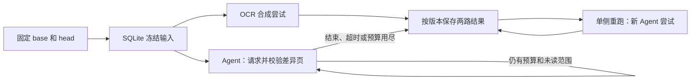

# 双评审阶段一实施与演示

2026-11-19 · PI-20261116-002

阶段一交付一个可反复运行的本地原型。用真实 Git 提交和 SQLite 验证输入、状态流转与结果版本，用合成 OCR 结果和脚本化假模型验证接线。假模型按固定标记产生候选，演示中的发现数量不用于评价模型准确率。

## 运行一次

在项目根目录执行。首次需要将锁定的依赖同步到仓库虚拟环境。

```sh
uv sync --locked --inexact
uv run --locked --offline python -m ocr_manager.review_prototype.demo
```

已同步依赖时，也可以直接使用原有虚拟环境：

```sh
PYTHONPATH=backend .venv/bin/python -m ocr_manager.review_prototype.demo
```

每次运行新建一个临时目录，包含三个独立 Git 仓库、`review.sqlite3` 和 `report.json`。它们的位置印在终端末尾。演示仅使用本机合成数据，未接入真实 OCR、模型端点、MCP、GitLab 或飞书。LangGraph 在原型内运行，显式关闭外部 tracing。

## 实施顺序与代码位置

| 顺序 | 实现 | 可以核对的行为 |
| --- | --- | --- |
| 1. 冻结输入 | [`input.py`](../backend/ocr_manager/review_prototype/input.py) 接收两个完整提交 SHA，解析 Git diff，为每块编号。仓库标识、范围模式、文件清单、差异、规则及背景标识共同生成输入摘要。 | 切换 `HEAD`、增加提交或改写工作区后，旧 SHA 仍生成相同输入。 |
| 2. 定义契约 | [`result.py`](../backend/ocr_manager/review_prototype/result.py) 定义覆盖、证据、发现与终态。 | `delivered_end` 表示已交付，`reviewed_end` 表示模型已返回且校验完成；二者可以不同。 |
| 3. 编排评审 | [`graph.py`](../backend/ocr_manager/review_prototype/graph.py) 用 LangGraph 串起模型请求、工具分页、模型返回、证据检查及结束分支。 | 可观察每一页的 `[起始, 结束)` 和续读位置，模型越过计划或引用未交付的行会失败。 |
| 4. 留存版本 | [`store.py`](../backend/ocr_manager/review_prototype/store.py) 原子创建比较和尝试，条件更新领取状态，脱离写事务执行模型，再保存终态。 | 重复请求复用编号；同请求键的不同输入或配置被拒绝；旧比较始终引用原尝试。 |
| 5. 串起演示 | [`demo.py`](../backend/ocr_manager/review_prototype/demo.py) 构造三个合成提交范围，运行五组比较，再重新打开数据库导出报告。 | 一份运行输出能看见成功、超时、预算不足、仅重跑 Agent 和重复请求。 |



图上的两条支路表示结果独立。演示同步执行，先保存 OCR 合成结果，再运行 Agent。两路均从 `queued` 进入 `running`，随后各自保存终态。模型声称发现问题时，程序检查差异块、文件、新旧侧行号和摘录是否与本页相符，通过才计入结果。程序只能验证引用和覆盖，业务主张是否成立仍需人工裁定。

## 一次实际运行的结果

| 比较 | OCR 尝试 | Agent 尝试 | Agent 终态 | 已核对 | 发现 |
| --- | --- | --- | --- | --- | --- |
| 1 · 有幂等保护的合成变更 | 1 | 2 | `complete` | 3/3 | 0 条 |
| 2 · 缺少保护的合成变更 | 3 | 4 | `complete` | 3/3 | 1 条 |
| 3 · 长差异首次运行超时 | 5 | 6 | `failed` | 0/25，已交付 5 条 | 0 条 |
| 4 · 同输入，限制只读一页 | 5 | 7 | `partial` | 5/25，剩余 20 条 | 0 条 |
| 5 · 同输入，允许读完 | 5 | 8 | `complete` | 25/25 | `orders.py` 新侧第 24 行 |

比较 3、4、5 使用同一输入摘要和 OCR 尝试 `#5`。每次单侧重跑从当前固定输入的新尝试开始，在尝试内部按页续读，旧尝试仍可查。对五组请求分别重复入队，比较编号均保持原值。数据库最终有 3 份输入、8 次尝试和 5 个比较版本。SHA 与临时目录随演示运行变化。

例如第 4 组，终端会出现如下节点事件：

```text
request · 模型请求块 1，起始 0
read · orders.py 块 1 [0,5)/25，续读位置 5
verified · 本页已核对，保留 0 条发现
finish · read_budget
Agent：running → partial，已核对 5/25 条差异记录，0 条发现
```

`0 条发现` 在这一行只说明已经核对的片段没有发现，终态 `partial` 同时披露了未评范围。第 5 组在 `[20,25)` 页才得到尾部证据。

## 怎么复核

打开 `report.json`，每条记录的 `comparison` 保存 OCR 和 Agent 尝试编号以及前一比较版本，`input` 保存提交、差异块清单和排除路径，`attempts` 保存各自配置、状态、覆盖、发现与节点轨迹。下列只读查询可核对版本引用。把示例路径换成终端输出的 SQLite 路径。

```sh
sqlite3 -readonly /path/to/review.sqlite3 \
  'SELECT c.id, c.previous_id, o.id, o.status, a.id, a.status
   FROM comparisons c JOIN attempts o ON c.ocr_id = o.id
   JOIN attempts a ON c.agent_id = a.id ORDER BY c.id'
```

专项验证：

```sh
.venv/bin/python -m pytest -q backend/tests/test_review_prototype.py
```

检查覆盖完整演示、固定输入、未读证据、越界分页、请求冲突和原子领取。业务库迁移、Worker 接入、图跨进程断点恢复和真实模型端点验证属于后续阶段。原型数据库保留输入与完整终态，能在进程结束后读取历史结果；对中途被杀死的运行，本阶段没有实现自动恢复。

2026-11-19 实际执行了离线演示和上面的只读 SQLite 查询。`uv lock --check`、`.venv/bin/ruff check backend`、`.venv/bin/mypy backend/ocr_manager` 及 `PYTHONPATH=backend .venv/bin/python -m ocr_manager.openapi_contract` 通过。`.venv/bin/python -m pytest -q` 的后端全量结果为 856 项通过、1 项跳过，包含原型的 5 项专项。没有部署阶段一原型。
